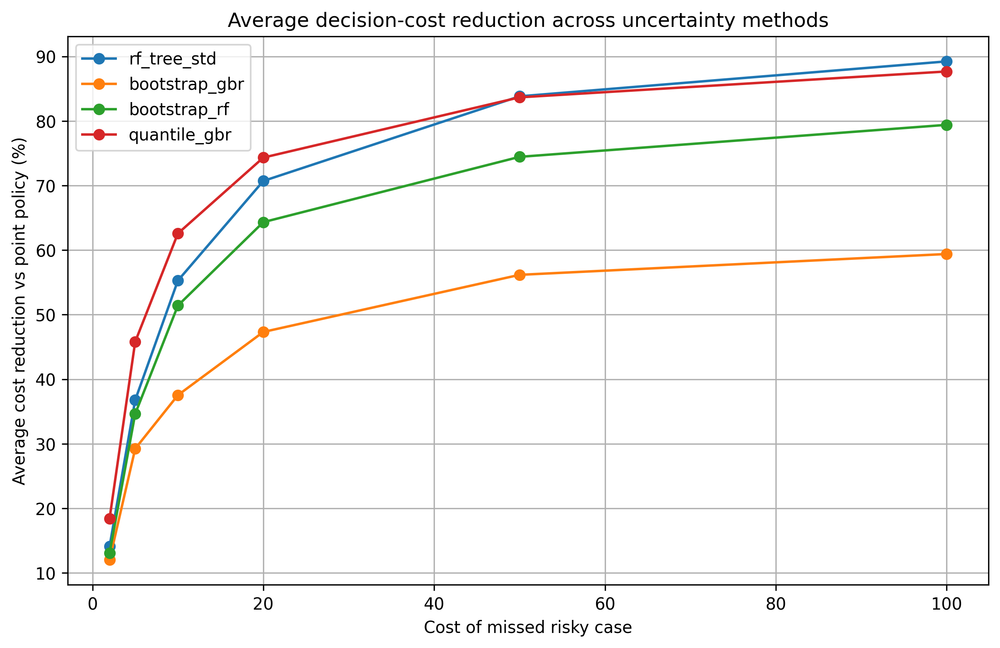
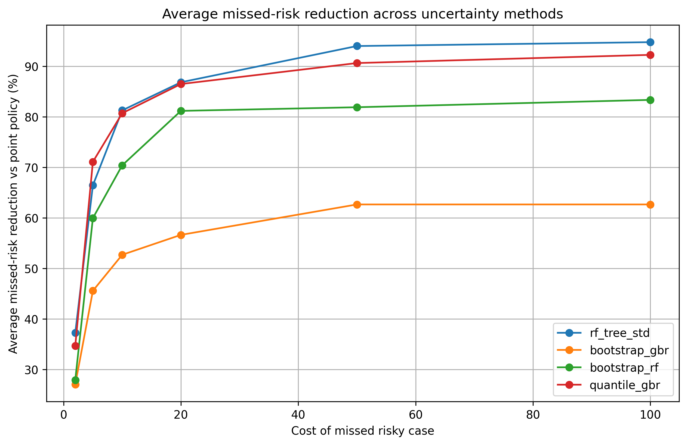

# Decision-Centric Evaluation of Uncertainty-Aware RUL Prediction

**Does uncertainty actually improve maintenance decisions when a missed failure costs far more than an unnecessary repair?**

This repo contains the code and results for a study of uncertainty-aware Remaining Useful Life (RUL) prediction on the NASA C-MAPSS turbofan benchmark. Instead of ranking models by MAE/RMSE or interval coverage, it scores them by the **asymmetric cost of the maintenance decisions they produce**.

> **Status:** research code accompanying a manuscript in preparation (*Decision-Centric Evaluation of Uncertainty-Aware Remaining Useful Life Prediction for Risk-Sensitive Predictive Maintenance*, Divyang Rajesh Mittal). The work has not been peer reviewed or published yet, and the numbers below may change before submission. A link will be added here once a preprint is available.

---

## TL;DR

- Overestimating RUL near failure is dangerous (breakdown). Underestimating it is cheap (early maintenance). Standard metrics ignore this asymmetry.
- I compare **four uncertainty methods** on **all four C-MAPSS subsets** (FD001–FD004) across **six missed-failure cost ratios** (2× to 100×).
- At a 20× cost ratio, **RF tree-disagreement** gets the lowest evaluation cost on every dataset (tied with Quantile-GBR on FD003): FD001 **410**, FD002 **2985**, FD003 **495**, FD004 **3901**.
- Averaged across datasets at 20×, the uncertainty-aware policy cuts total cost by **~71%** and missed failures by **~87%** versus the point-prediction policy (RF tree-disagreement).
- **Method choice matters.** Bootstrap Gradient Boosting barely helps on the multi-condition datasets (FD002/FD004), cutting missed failures by only 33–40% even with large safety margins.

---

## The idea

A point model predicts RUL `ŷ`. An uncertainty-aware model also produces a spread `σ`. The maintenance policy subtracts a safety margin from the prediction:

```
ŷ_cons = ŷ − k · σ          trigger maintenance if ŷ_cons ≤ τ
```

- `τ = 20` cycles is the maintenance threshold. A "risky" engine-cycle is one where true RUL ≤ τ.
- `k ≥ 0` is a **safety coefficient** that controls how conservative the policy is.
- Total decision cost is `Cost = c_fp · FP + c_fn · FN`, with `c_fp = 1` and `c_fn ∈ {2, 5, 10, 20, 50, 100}`.
- For each method and each cost ratio, `k` is **chosen on held-out calibration engines** by minimizing cost, then **applied to unseen evaluation engines**. As missed failures get more expensive, calibration picks a larger `k` and maintenance triggers earlier. So `k` works as a risk-control dial.

## Methods compared

| Method | How uncertainty `σ` is obtained |
|---|---|
| `rf_tree_std` | Random Forest. Prediction is the mean over trees; `σ` is the std of individual tree predictions. No extra training cost. |
| `bootstrap_rf` | 20 Random Forests trained on engine-wise bootstrap resamples; `σ` is the std across the ensemble. |
| `bootstrap_gbr` | 20 Gradient Boosting regressors on engine-wise bootstrap resamples; `σ` is the std across the ensemble. |
| `quantile_gbr` | Three Gradient Boosting quantile models (q = 0.10, 0.50, 0.90). Median is the prediction; `σ = ŷ₀.₅₀ − ŷ₀.₁₀`. Gives interpretable 10–90% intervals. |

Bootstrap resampling is done **at the engine level** to preserve temporal trajectory structure.

## Experimental setup

- **Data:** NASA C-MAPSS (FD001–FD004). This is simulated **aircraft turbofan** run-to-failure data. The method itself is not engine-specific, but the results here are only for this benchmark.
- **RUL target** capped at 140 cycles.
- **Features:** 3 operational settings, 5 sensor channels (`s7, s12, s14, s20, s21`), and rolling mean/std over a 5-cycle window.
- **Split:** the final experiments use only the NASA **training** files. Their engines are split **by engine** into 60% train / 20% calibration / 20% evaluation (seed 42). No cycles from evaluation engines appear in training or calibration, so there is no leakage. The NASA test files are not used.

| Dataset | Engines in NASA train file | Operating conditions | Fault modes |
|---|---|---|---|
| FD001 | 100 | 1 | 1 |
| FD002 | 260 | 6 | 1 |
| FD003 | 100 | 1 | 2 |
| FD004 | 248 | 6 | 2 |

---

## Results

### Headline: evaluation cost at c_fn = 20

Lower is better. "Point" is the same model's policy with no safety margin (`k = 0`).

| Dataset | Method | Point cost | Uncertainty-aware cost | Cost reduction | Missed-failure (FN) reduction |
|---|---|---:|---:|---:|---:|
| FD001 | **rf_tree_std** | 1264 | **410** | 67.6% | 85.2% |
| FD001 | quantile_gbr | 1271 | 414 | 67.4% | 82.0% |
| FD001 | bootstrap_rf | 1204 | 588 | 51.2% | 77.6% |
| FD001 | bootstrap_gbr | 1407 | 573 | 59.3% | 69.1% |
| FD002 | **rf_tree_std** | 12473 | **2985** | 76.1% | 91.4% |
| FD002 | quantile_gbr | 17270 | 3162 | 81.7% | 94.3% |
| FD002 | bootstrap_rf | 12875 | 3741 | 70.9% | 83.4% |
| FD002 | bootstrap_gbr | 17971 | 12460 | 30.7% | 32.6% |
| FD003 | **rf_tree_std** | 1637 | **495** | 69.8% | 88.8% |
| FD003 | **quantile_gbr** | 1762 | **495** | 71.9% | 83.5% |
| FD003 | bootstrap_rf | 1763 | 566 | 67.9% | 84.9% |
| FD003 | bootstrap_gbr | 1521 | 582 | 61.7% | 84.9% |
| FD004 | **rf_tree_std** | 12764 | **3901** | 69.4% | 82.0% |
| FD004 | quantile_gbr | 16946 | 4020 | 76.3% | 86.3% |
| FD004 | bootstrap_rf | 12780 | 4178 | 67.3% | 78.9% |
| FD004 | bootstrap_gbr | 17686 | 11036 | 37.6% | 39.9% |

Note that the percentage reductions are relative to each method's own point baseline, so compare **absolute cost** across methods. This is why `quantile_gbr` can show a larger percentage reduction than `rf_tree_std` on FD002 while still having a slightly higher final cost: its point baseline starts out worse.

### Average cost reduction across datasets, by cost ratio

| Method | c_fn=2 | 5 | 10 | 20 | 50 | 100 |
|---|---:|---:|---:|---:|---:|---:|
| rf_tree_std | 14.1% | 36.8% | 55.3% | 70.7% | 83.8% | 89.2% |
| quantile_gbr | 18.4% | 45.8% | 62.6% | 74.3% | 83.7% | 87.7% |
| bootstrap_rf | 13.1% | 34.6% | 51.4% | 64.3% | 74.4% | 79.4% |
| bootstrap_gbr | 12.0% | 29.2% | 37.5% | 47.3% | 56.2% | 59.4% |

### Quantile-GBR interval quality (nominal 10–90% interval)

| Dataset | Coverage | Mean width (cycles) | MAE |
|---|---:|---:|---:|
| FD001 | 0.778 | 48.83 | 16.91 |
| FD002 | 0.869 | 92.33 | 28.03 |
| FD003 | 0.811 | 47.10 | 14.75 |
| FD004 | 0.854 | 83.60 | 30.35 |

### Figures




---

## Key takeaways

1. **Uncertainty helps decisions.** Across methods, uncertainty-aware policies cut missed failures and total asymmetric cost versus point-prediction baselines.
2. **The cheapest method is among the best.** `rf_tree_std` needs one Random Forest and no extra training, yet gets the lowest absolute cost on all four datasets (tied on FD003).
3. **Quantile-GBR is the interpretable alternative.** It is closely competitive and gives actual prediction intervals that can be communicated to operators, at the price of training three models.
4. **Good intervals ≠ good decisions.** `bootstrap_gbr` gets reasonable coverage on FD001/FD003 but fails to translate it into decision value on the six-condition datasets.
5. **The more a missed failure costs, the earlier the policy triggers.** Calibrated `k` rises with `c_fn`, so uncertainty acts as a tunable operational risk lever.

## Limitations

- **Single benchmark family.** Everything is on C-MAPSS; results may not transfer to other degradation mechanisms.
- **Cycle-level decisions.** The analysis is per timestep, not a sequential scheduling problem.
- **Synthetic cost ratios.** Real cost ratios depend on the asset and the consequence of failure.
- **Fixed threshold.** `τ = 20` is not optimized jointly with `k`.
- **Classical ML only.** LSTMs/Transformers are not evaluated.
- **`k` is not comparable across methods.** Each method's `σ` has a different scale, so compare costs, not `k` values.

---

## Repository structure

```
.
├── data/
│   ├── raw/          # NASA C-MAPSS files (train_/test_/RUL_FD00x.txt)
│   └── processed/    # per-run CSVs written by the scripts
├── notebooks/        # 01-07 numbered analysis notebooks + eda_01
├── reports/
│   ├── method_comparison/        # aggregated result tables (CSV) and figures
│   └── final_rf_tree_baseline/   # plots for the RF tree-disagreement baseline
├── scripts/          # experiment runners (see below)
├── src/
│   ├── config.py     # paths, RUL cap, seed, selected sensors
│   ├── data/         # loading
│   ├── features/     # RUL target, rolling features, engine-wise splits
│   ├── models/       # baseline models
│   ├── uncertainty/  # RF tree std, bootstrap ensembles, quantile models
│   ├── evaluation/   # maintenance policy and k-sweeps
│   └── visualization/
└── README.md
```

## Reproducing the results

1. **Data.** The C-MAPSS files are already in `data/raw/`. They come from the NASA Prognostics Data Repository (see `data/raw/readme.txt` and the reference below).
2. **Environment.** Python 3 with `numpy`, `pandas`, `scikit-learn` and `matplotlib` (plus `jupyter` for the notebooks). A pinned `requirements.txt` is not included yet.
3. **Run the experiments** from the repo root so that `src` is importable:

```bash
export PYTHONPATH=.

python scripts/run_clean_split_rf_policy.py                                      # rf_tree_std
python scripts/run_clean_split_bootstrap_policy_all_datasets.py --model_type rf  # bootstrap_rf
python scripts/run_clean_split_bootstrap_policy_all_datasets.py --model_type gbr # bootstrap_gbr
python scripts/run_clean_split_quantile_policy_all_datasets.py                   # quantile_gbr
```

   Each script runs all four datasets and all six cost ratios. For every dataset it chooses `k` on the calibration engines and reports cost on the evaluation engines. Per-dataset outputs and an `all_datasets_*_clean_cal_to_eval_summary.csv` are written to `data/processed/`. The seed is fixed at 42.
4. **Aggregated tables and figures** are in `reports/method_comparison/`. Notebook `07_clean_split_results_analysis.ipynb` analyses the clean-split results.

**Earlier exploratory scripts.** Scripts such as `run_all_datasets_uncertainty_policy.py` come from an earlier stage of the project. They pick `k` on the same validation split they report on, so they are not used for the headline results. The `run_clean_split_*` scripts above are the ones that follow the calibration → evaluation protocol described in this README.

## Citation

No preprint is available yet. Citation details will be added here when the manuscript is public.

## License

Code is released under the MIT License (see `LICENSE`). The C-MAPSS data belongs to NASA; see `data/raw/readme.txt` for its terms and provenance.

## Reference

Saxena, A., Goebel, K., Simon, D., & Eklund, N. (2008). *Damage propagation modeling for aircraft engine run-to-failure simulation.* Proc. 1st Int. Conf. on Prognostics and Health Management (PHM).